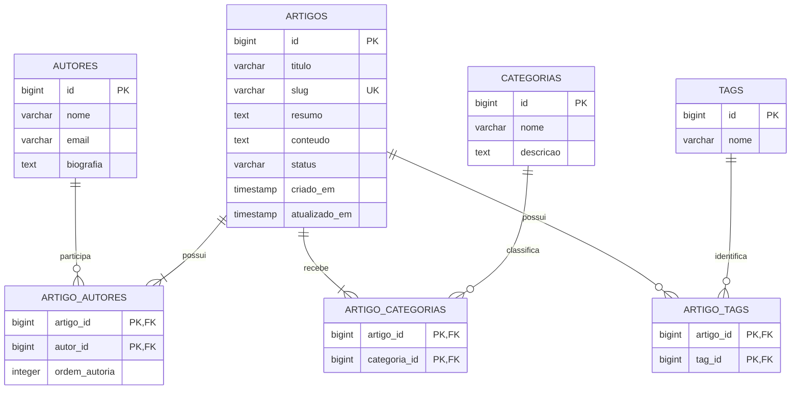

# DER — Knowledge Base

**Projeto:** Knowledge Base  
**Disciplina:** Banco de Dados II  
**Versão:** 1.0  
**Status:** Modelagem conceitual definida

## 1. Objetivo

Definir as entidades, atributos e relacionamentos necessários para armazenar, organizar e recuperar artigos.

A modelagem considera a utilização de PostgreSQL como banco relacional principal e um mecanismo externo especializado em busca textual, conforme a Trilha 2 do projeto.

## 2. Regras de negócio

1. Um artigo deverá possuir pelo menos um autor.
2. Um artigo poderá possuir vários autores.
3. Um artigo deverá pertencer a pelo menos uma categoria.
4. Um artigo poderá pertencer a várias categorias.
5. Um artigo poderá possuir várias tags.
6. Uma tag poderá estar associada a vários artigos.
7. Artigos poderão ter os status `rascunho`, `publicado` ou `arquivado`.
8. Artigos arquivados poderão ser republicados.
9. Artigos não poderão ser cadastrados com informações obrigatórias incompletas.
10. Cada artigo possuirá um slug único para identificação amigável.
11. O projeto não manterá histórico de versões dos artigos nesta primeira versão.

## 3. Entidades

### 3.1. AUTORES

Armazena as informações das pessoas responsáveis pela produção dos artigos.

| Atributo | Descrição |
|---|---|
| id | Identificador do autor |
| nome | Nome do autor |
| email | E-mail do autor |
| biografia | Descrição do autor |

### 3.2. ARTIGOS

Armazena os conteúdos publicados ou cadastrados no sistema.

| Atributo | Descrição |
|---|---|
| id | Identificador do artigo |
| titulo | Título do artigo |
| slug | Identificador textual único |
| resumo | Resumo do conteúdo |
| conteudo | Texto completo |
| status | Situação de publicação |
| criado_em | Data de criação |
| atualizado_em | Data da última atualização |

### 3.3. CATEGORIAS

Organiza os artigos por assunto.

| Atributo | Descrição |
|---|---|
| id | Identificador da categoria |
| nome | Nome da categoria |
| descricao | Descrição da categoria |

### 3.4. TAGS

Armazena palavras-chave utilizadas para identificar e localizar conteúdos.

| Atributo | Descrição |
|---|---|
| id | Identificador da tag |
| nome | Nome da palavra-chave |

## 4. Tabelas associativas

Como existem relacionamentos muitos para muitos, serão utilizadas tabelas intermediárias.

### 4.1. ARTIGO_AUTORES

Relaciona artigos aos seus autores.

| Atributo | Descrição |
|---|---|
| artigo_id | Referência ao artigo |
| autor_id | Referência ao autor |
| ordem_autoria | Ordem de apresentação dos autores |

### 4.2. ARTIGO_CATEGORIAS

Relaciona artigos às categorias.

| Atributo | Descrição |
|---|---|
| artigo_id | Referência ao artigo |
| categoria_id | Referência à categoria |

### 4.3. ARTIGO_TAGS

Relaciona artigos às palavras-chave.

| Atributo | Descrição |
|---|---|
| artigo_id | Referência ao artigo |
| tag_id | Referência à tag |

## 5. Diagrama Entidade-Relacionamento

## 6. Relacionamentos

| Relacionamento | Cardinalidade | Explicação |
|---|---|---|
| Autores × Artigos | N:N | Um autor pode escrever vários artigos e um artigo pode ter vários autores. |
| Artigos × Categorias | N:N | Um artigo pode pertencer a várias categorias e uma categoria pode organizar vários artigos. |
| Artigos × Tags | N:N | Uma tag pode identificar vários artigos e um artigo pode possuir várias tags. |

## 7. Chaves e integridade

As tabelas principais utilizarão identificadores próprios como chaves primárias.

As tabelas associativas utilizarão chaves primárias compostas pelos identificadores das entidades relacionadas.

As referências serão implementadas por meio de chaves estrangeiras.

**Regra importante:** uma chave estrangeira garante que o autor ou a categoria relacionados existam, mas não garante sozinha que todo artigo tenha pelo menos um autor e uma categoria.

Essa regra deverá ser garantida durante a operação de cadastro, preferencialmente com transação no banco e validação no backend.

O slug deverá possuir uma restrição de unicidade.

## 8. Status dos artigos

| Status | Significado |
|---|---|
| rascunho | Artigo cadastrado, mas ainda não publicado |
| publicado | Artigo disponível para consulta |
| arquivado | Artigo retirado da publicação, mas preservado |

Um artigo arquivado poderá voltar ao estado publicado.

## 9. Decisões fora do escopo inicial

- Histórico de versões dos artigos.
- Controle avançado de permissões.
- Interface gráfica.
- Gerenciamento de múltiplas organizações.

Essas funcionalidades poderão ser consideradas em futuras evoluções, mas não fazem parte da modelagem inicial.

## 10. Próximas etapas

- [x] Definir entidades principais.
- [x] Definir relacionamentos.
- [x] Definir regras de negócio.
- [x] Definir status de publicação.
- [x] Definir utilização de slug.
- [ ] Revisar os atributos e tipos de dados.
- [ ] Definir o schema físico do PostgreSQL.
- [ ] Criar o arquivo SQL de implementação.
- [ ] Implementar e testar as restrições de integridade.

## 11. Histórico de alterações

| Versão | Descrição |
|---|---|
| 0.1 | Planejamento inicial da modelagem. |
| 1.0 | Definição das entidades, relacionamentos e regras de negócio. |
